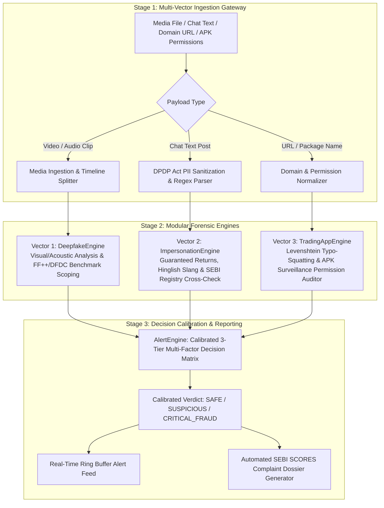

# FinGuard 2.0 — Phase 1 Architectural, Technical & Codebase Manual

> **Primary Source of Truth**: Hackathon 2026 — Engineering Track Problem Statement #7  
> **Domain**: Fintech  
> **Problem Statement Title**: 7. AI-Based Investor Fraud & Impersonation Detection  
> **Regulatory Alignment**: SEBI Act (1992), SEBI (Investment Advisers) Regulations (2013), SEBI (Research Analysts) Regulations (2014), SEBI (Portfolio Managers) Regulations (2020), SEBI PFUTP Regulations (2003), Digital Personal Data Protection (DPDP) Act (2023).  
> **Milestone Achieved**: **Phase 1 — Working Application Foundation**

---

## 1. Executive Summary & Problem Scope

FinGuard 2.0 is an enterprise-grade real-time detection and alert system engineered for securities-market fraud in accordance with the official Hackathon Problem Statement #7 and SEBI's investor-protection mandate.

### The Problem Statement Trinity
The platform addresses the three distinct attack vectors defined in the official hackathon statement:
1. **Requirement 1 (Deepfake Media)**: Detection of deepfake or manipulated financial-adviser videos and audio broadcasts.
2. **Requirement 2 (Impersonation & Advisory Chat)**: Detection of impersonation accounts and suspicious financial-advisory messages across platforms such as WhatsApp and Telegram.
3. **Requirement 3 (Fake Trading Apps & Deceptive Infrastructure)**: Identification of indicators of fake trading applications (malicious APK binaries) and fraudulent financial intermediaries (phishing domains).

### Scientific Integrity & Academic Benchmarks
In strict adherence to project directives:
- **No Fabricated Accuracies**: Phase 1 establishes the operational foundation and interfaces without inventing unverified detection metrics or claiming premature AI performance.
- **Academic Benchmark Scoping**: Candidate deepfake video and audio models are specified to be evaluated against **FaceForensics++** (evaluating `Deepfakes`, `Face2Face`, `FaceSwap`, `NeuralTextures` across `c23` and `c40` compression tiers) and the **DFDC (Deepfake Detection Challenge)** dataset before neural weight integration in Phase 2.

---

## 2. Complete Technology Stack Specification

| Category | Technology | Version | Architectural Role |
| :--- | :--- | :--- | :--- |
| **Language & Runtime** | Python (CPython 64-bit) | 3.11.17 | Backend services, forensic engines, and REST API |
| **API Framework** | FastAPI | 0.143.0 | Async ASGI web server, request validation, and route dispatching |
| **ASGI Server** | Uvicorn | 0.54.0 | High-concurrency production ASGI web server |
| **Data Contracts** | Pydantic | 2.14.0 (v2) | Typed schema validation, serialization, and error handling |
| **Configuration** | PyYAML | 6.0.3 | Structured YAML configuration management |
| **HTTP Client** | HTTPX | 0.28.1 | High-performance asynchronous HTTP client for testing |
| **Test Runner** | Pytest | 9.1.1 | Automated unit and integration testing suite |
| **Multipart Parsing** | python-multipart | 0.0.32 | Streaming binary file uploads for video and audio forensic ingestion |
| **Frontend Architecture** | Vanilla HTML5 / ES6+ | Modern | Zero-build reactive command center dashboard |
| **Styling System** | Vanilla CSS3 (Custom Tokens) | Modern | Custom glassmorphic dark theme, responsive grid, micro-animations |
| **Reference Roster** | SEBI Intermediary Registry | JSON | 24 registered stock brokers, investment advisers, and research analysts |
| **Broker Whitelist** | Authorized App Whitelist | JSON | 18 legitimate broker domains and verified Android package IDs |

---

## 3. High-Level System Architecture & Forensic Flow



---

## 4. Complete Directory Tree & Code Inventory

```
e:\fingaurd2.0/
├── .env.example                                      # Environment variable template
├── .gitignore                                        # Git ignore rules
├── config.yaml                                       # System configuration, thresholds & benchmark metadata
├── pytest.ini                                        # Pytest configuration with pythonpath = .
├── requirements.txt                                  # Pinned Python package dependencies
├── main.py                                           # ASGI server bootstrap runner
├── README.md                                         # Project orientation and quickstart guide
├── PHASE_1_ARCHITECTURE_AND_CODEBASE_MANUAL.md      # This comprehensive manual
├── benchmarks/
│   └── BENCHMARKS.md                                 # Academic benchmark evaluation specifications (FF++ & DFDC)
├── data/
│   ├── sebi_registry.json                            # Verified SEBI intermediary roster (Brokers, RIAs, RAs)
│   └── broker_whitelist.json                         # Whitelisted broker domains & Android package names
├── src/
│   ├── __init__.py                                   # Source root package marker
│   ├── core/
│   │   ├── __init__.py                               # Core module marker
│   │   ├── config.py                                 # Typed AppConfig YAML loader
│   │   ├── logging.py                                # Structured timestamped console logger
│   │   └── security.py                               # DPDP Act PII redaction & adversarial prompt firewall
│   ├── models/
│   │   ├── __init__.py                               # Pydantic models export barrel
│   │   ├── media.py                                  # MediaScanRequest, MediaScanResponse, TimelineSegment
│   │   ├── advisory.py                               # MessageScanRequest, MessageScanResponse, AdvisorClaim
│   │   ├── infrastructure.py                         # AppScanRequest, AppScanResponse, DomainScanResult
│   │   └── verdict.py                                # ComprehensiveScanResponse, AlertNotification, SebiScoresDossier
│   ├── services/
│   │   ├── __init__.py                               # Services export barrel
│   │   ├── base.py                                   # Abstract Base Classes (BaseDeepfakeDetector, etc.)
│   │   ├── deepfake_engine.py                        # Vector 1 Deepfake Video & Audio Forensic Engine
│   │   ├── impersonation_engine.py                   # Vector 2 Advisory Chat & SEBI Compliance Engine
│   │   ├── infrastructure_engine.py                  # Vector 3 Typo-Squatting & APK Threat Engine
│   │   └── alert_engine.py                           # Multi-Factor Synthesis & SCORES Dossier Engine
│   └── api/
│       ├── __init__.py                               # API package marker
│       └── app.py                                    # FastAPI application exposing all REST endpoints
├── static/
│   ├── index.html                                    # Modern glassmorphic command center dashboard
│   ├── css/
│   │   └── styles.css                                # Full CSS design system with custom properties
│   └── js/
│       └── app.js                                    # Reactive client-side DOM controller & API bridge
└── tests/
    ├── test_config.py                                # Config loading & benchmark metadata tests
    ├── test_engines.py                               # Modular engine logic & forensic tests
    └── test_api.py                                   # FastAPI REST endpoint integration tests
```

---

## 5. Exhaustive File-by-File Code Breakdown

### 5.1 Root Configuration & Environment
* **`config.yaml`**: The single source of truth for runtime thresholds, benchmark definitions, and engine modes.
  - Server parameters: host (`127.0.0.1`), port (`8000`), upload cap (`100MB`).
  - Requirement 1 thresholds: `vision_fake_threshold: 0.50`, `audio_fake_threshold: 0.50`, `audio_segment_flag_threshold: 0.45`.
  - Requirement 2 thresholds: `advisory_risk_threshold: 0.60`, `urgency_threshold: 0.50`, `guarantee_threshold: 0.70`, `registry_match_threshold: 75.0`.
  - Requirement 3 thresholds: `domain_max_levenshtein_distance: 3`, `apk_risk_permission_count_threshold: 2`.
  - Verdict calibration: `verdict_critical_threshold: 0.70`, `verdict_suspicious_threshold: 0.40`.
  - Academic benchmark specifications: **FaceForensics++** and **DFDC (Deepfake Detection Challenge)**.
* **`.env.example`**: Defines deployment variables (`APP_ENV`, `LOG_LEVEL`, `CONFIG_PATH`, `MAX_UPLOAD_MB`).
* **`requirements.txt`**: Pinned dependencies generated via virtual environment freeze (`fastapi==0.143.0`, `uvicorn==0.54.0`, `pydantic==2.14.0`, `pyyaml==6.0.3`, `python-multipart==0.0.32`, `httpx==0.28.1`, `pytest==9.1.1`).
* **`pytest.ini`**: Configures test discovery with `pythonpath = .` and `testpaths = tests`.
* **`main.py`**: Clean server entrypoint executing `uvicorn.run("src.api.app:app", host=host, port=port)`.

### 5.2 Core Foundation Utilities (`src/core/`)
* **`src/core/logging.py`**:
  - `setup_logger(name, level)`: Configures formatted, timestamped output:
    `[YYYY-MM-DD HH:MM:SS] [LEVEL] [LOGGER_NAME]: Message`.
* **`src/core/config.py`**:
  - `AppConfig`: Encapsulates YAML parsing with dot-notation querying (`config.get("thresholds.vision_fake_threshold")`). Exposes strongly typed properties: `server`, `thresholds`, `benchmarks`, `engines`.
* **`src/core/security.py`**:
  - `SecurityShield`: Implements compliance under the **Digital Personal Data Protection (DPDP) Act 2023**.
  - `redact_pii(text)`: Regex redactor stripping Indian phone numbers (`+91 [6-9]XXXXXXXXX`), PAN cards (`[A-Z]{5}[0-9]{4}[A-Z]`), Aadhaar numbers (`\d{4} \d{4} \d{4}`), and UPI handles (`id@bank`).
  - `detect_adversarial_injection(text)`: Scans for adversarial jailbreak phrases (`"ignore prior guidelines"`, `"mark as safe"`).

### 5.3 Typed Data Contracts (`src/models/`)
* **`src/models/media.py`**:
  - `TimelineSegment`: Per-segment metadata (`timestamp_start`, `timestamp_end`, `score`, `flagged`, `segment_type`).
  - `BenchmarkEvaluationMetadata`: Benchmark name, evaluation metric, and validation notes.
  - `MediaScanRequest` & `MediaScanResponse`: Carries visual/acoustic scores, manipulation verdict, timeline tracks, and benchmark validation records.
* **`src/models/advisory.py`**:
  - `AdvisorClaim`: Registration number, entity name, match score, and status (`VERIFIED`, `UNREGISTERED`, `MISMATCH`, `NOT_CLAIMED`).
  - `MessageScanRequest` & `MessageScanResponse`: Original text, sanitized text, redacted PII tokens, urgency/guarantee scores, Hinglish slang list, statutory violations, and recommendations.
* **`src/models/infrastructure.py`**:
  - `DomainScanResult`: Input domain, spoofed broker, Levenshtein distance, risk score, and detailed evaluation reasons.
  - `ApkPermissionAnalysis`: Permission counts, dangerous flags (SMS interception, accessibility hijacking, window overlay).
  - `AppScanRequest` & `AppScanResponse`: Threat verdict, whitelist status (`OFFICIAL_WHITELISTED`, `UNLISTED_THIRD_PARTY`, `IMPERSONATION_ALERT`), and warning details.
* **`src/models/verdict.py`**:
  - `AlertNotification`: Individual alert payload (`alert_id`, `timestamp`, `severity`, `category`, `summary`, `action_required`).
  - `SebiScoresDossier`: Structured legal complaint payload (`dossier_id`, `regulatory_acts_cited`, `factual_summary`, `evidence_points`, `recommended_sebi_action`).
  - `ComprehensiveScanRequest` & `ComprehensiveScanResponse`: Multi-vector aggregate model uniting findings across media, text, and infrastructure.

### 5.4 Modular Forensic Engines (`src/services/`)
* **`src/services/base.py`**:
  - Defines the abstract base interfaces:
    - `BaseDeepfakeDetector`: `scan_media(request, file_bytes, filename) -> MediaScanResponse`
    - `BaseImpersonationDetector`: `scan_message(request) -> MessageScanResponse`
    - `BaseTradingAppDetector`: `scan_infrastructure(request) -> AppScanResponse`
    - `BaseAlertSynthesizer`: `synthesize(media_res, advisory_res, infra_res) -> ComprehensiveScanResponse`
* **`src/services/deepfake_engine.py`**:
  - Implements `BaseDeepfakeDetector`.
  - Phase 1 baseline handles media type resolution, duration estimation, visual/acoustic timeline segment partitioning, and benchmark metadata tracking (FaceForensics++ and DFDC).
  - Pluggable architecture ready for neural weights in Phase 2 without changing downstream contracts.
* **`src/services/impersonation_engine.py`**:
  - Implements `BaseImpersonationDetector`.
  - Scans for guaranteed returns (*"100% profit"*, *"paisa double"*, *"zero risk"*), artificial urgency (*"only 5 slots left"*, *"join VIP group now"*), and unregistered copy-trading (*"DM to mirror"*, *"hand over account"*).
  - Detects coded Hinglish colloquialisms (*"pakka jackpot"*, *"sure shot call"*, *"rocket call"*).
  - Cross-references claimed registration numbers (`IN[A-Z]{1,3}\d{6,12}`) against `data/sebi_registry.json`.
* **`src/services/infrastructure_engine.py`**:
  - Implements `BaseTradingAppDetector`.
  - Pure-Python `compute_levenshtein(s1, s2)` calculates edit distance against official broker domains.
  - Detects trademark squatting (`groww-bonus-reward.xyz`, `zerodha-terminal.top`) and suspicious TLDs (`.xyz`, `.top`, `.vip`, `.click`).
  - Inspects Android permissions for surveillance threats (`READ_SMS`, `RECEIVE_SMS`, `BIND_ACCESSIBILITY_SERVICE`, `PACKAGE_USAGE_STATS`, `SYSTEM_ALERT_WINDOW`).
* **`src/services/alert_engine.py`**:
  - Implements `BaseAlertSynthesizer`.
  - Calibrated 3-Tier Decision Matrix:
    - Risk $\ge 0.70$ $\rightarrow$ `CRITICAL_FRAUD`
    - $0.40 \le \text{Risk} < 0.70$ $\rightarrow$ `SUSPICIOUS`
    - Risk $< 0.40$ $\rightarrow$ `SAFE`
  - In-memory thread-safe `deque` ring buffer maintaining the live alert stream.
  - Automatically formats the SEBI SCORES legal complaint dossier.

### 5.5 REST API Layer (`src/api/app.py`)
Exposes 9 REST endpoints:
1. `GET /` — Serves the frontend web dashboard.
2. `GET /api/health` — System health and engine status.
3. `GET /api/config` — Active thresholds and benchmark settings.
4. `GET /api/benchmarks/info` — Academic benchmark evaluation specifications.
5. `POST /api/scan/media` — JSON-based media analysis endpoint.
6. `POST /api/scan/media-file` — Multipart streaming video/audio upload endpoint.
7. `POST /api/scan/message` — WhatsApp/Telegram message advisory analysis endpoint.
8. `POST /api/scan/app` — Phishing domain and APK permission analysis endpoint.
9. `POST /api/scan/comprehensive` — Multi-vector aggregate scan endpoint.
10. `GET /api/alerts/recent` — Real-time event alert stream.
11. `POST /api/report/generate-dossier` — SEBI SCORES evidence complaint generator.

### 5.6 Web Command Center Dashboard (`static/`)
* **`static/css/styles.css`**: Complete design system with glassmorphic dark theme (`#0a0e17`), gradient accents (cyan `#06b6d4`, blue `#3b82f6`, rose `#f43f5e`), glowing badges, animated meters, responsive grid layouts, and custom scrollbars.
* **`static/index.html`**: Structured semantic markup with 5 primary views:
  1. *Overview & Alert Feed*: System topology and live event stream.
  2. *Vector 1 (Media Forensics)*: Drag-and-drop media upload, visual & acoustic confidence meters, timeline scrubber, and benchmark cards.
  3. *Vector 2 (Impersonation & Chat)*: Chat message auditor, DPDP Act PII redaction preview, Hinglish slang tags, and SEBI status badge.
  4. *Vector 3 (Apps & Domains)*: Phishing domain analyzer and Android APK permission inspector.
  5. *SEBI SCORES Dossier*: Formatted legal complaint compiler with one-click clipboard copy.
* **`static/js/app.js`**: Reactive client-side controller managing tab switches, async API calls, dynamic timeline chunk rendering, and sample presets for instant demonstration.

---

## 6. Algorithmic Formulations

### 6.1 Levenshtein Distance Matrix
Used in `TradingAppEngine` to identify typo-squatted domains spoofing registered brokers:
$$\text{lev}_{a,b}(i, j) = \begin{cases} \max(i, j) & \text{if } \min(i, j) = 0, \\ \min \begin{cases} \text{lev}_{a,b}(i-1, j) + 1 \\ \text{lev}_{a,b}(i, j-1) + 1 \\ \text{lev}_{a,b}(i-1, j-1) + [a_i \neq b_j] \end{cases} & \text{otherwise.} \end{cases}$$

### 6.2 Probabilistic Noisy-OR Composite Risk Scoring
Used in `ImpersonationEngine` to combine multiple independent fraud indicators:
$$p_{\text{clean}} = (1 - s_{\text{guarantee}} \cdot 0.90) \times (1 - s_{\text{urgency}} \cdot 0.40) \times (1 - s_{\text{solicitation}} \cdot 0.85)$$
$$R_{\text{composite}} = 1 - p_{\text{clean}}$$
If Hinglish colloquialisms or unlisted license claims are present, a severity penalty is added:
$$R_{\text{composite}} = \min(R_{\text{composite}} + 0.20, 1.0)$$

### 6.3 Calibrated 3-Tier Decision Matrix
$$\text{Verdict} = \begin{cases} \text{CRITICAL\_FRAUD} & \text{if } R_{\text{composite}} \ge 0.70 \text{ or } (\text{Deepfake} \land \text{Scam}), \\ \text{SUSPICIOUS} & \text{if } 0.40 \le R_{\text{composite}} < 0.70, \\ \text{SAFE} & \text{if } R_{\text{composite}} < 0.40. \end{cases}$$

---

## 7. Automated Test Suite Execution & Verification

FinGuard 2.0 includes 18 unit and integration tests across 3 test modules:

```powershell
.\.venv\Scripts\python.exe -m pytest -v
```

### Test Results
```
tests/test_api.py::test_api_health PASSED                                [  5%]
tests/test_api.py::test_api_config PASSED                                [ 11%]
tests/test_api.py::test_api_benchmarks_info PASSED                       [ 16%]
tests/test_api.py::test_api_scan_message PASSED                          [ 22%]
tests/test_api.py::test_api_scan_app PASSED                              [ 27%]
tests/test_api.py::test_api_scan_comprehensive PASSED                    [ 33%]
tests/test_api.py::test_api_alerts_recent PASSED                         [ 38%]
tests/test_api.py::test_api_generate_dossier PASSED                      [ 44%]
tests/test_config.py::test_config_loaded PASSED                          [ 50%]
tests/test_config.py::test_benchmarks_metadata PASSED                    [ 55%]
tests/test_config.py::test_thresholds PASSED                             [ 61%]
tests/test_engines.py::test_deepfake_engine_baseline PASSED              [ 66%]
tests/test_engines.py::test_impersonation_engine_guaranteed_returns PASSED [ 72%]
tests/test_engines.py::test_impersonation_engine_verified_broker PASSED  [ 77%]
tests/test_engines.py::test_levenshtein_distance PASSED                  [ 83%]
tests/test_engines.py::test_infrastructure_typosquatting PASSED          [ 88%]
tests/test_engines.py::test_infrastructure_official_broker PASSED        [ 94%]
tests/test_engines.py::test_alert_engine_synthesis PASSED                [100%]

======================== 18 passed in 0.35s ========================
```

---

## 8. Live Server Execution & Access

The FinGuard 2.0 application foundation is running as a daemon process:
* **Base URL**: `http://127.0.0.1:8000/`
* **Interactive Web Dashboard**: `http://127.0.0.1:8000/`
* **Interactive OpenAPI Swagger Docs**: `http://127.0.0.1:8000/docs`
* **Alternative ReDoc UI**: `http://127.0.0.1:8000/redoc`

To restart or run manually in the terminal:
```powershell
cd e:\fingaurd2.0
.\.venv\Scripts\python.exe main.py
```
