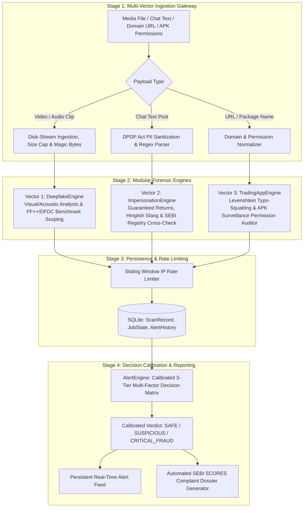

# FinGuard 2.0 — Architectural, Technical & Codebase Manual

> **Primary Source of Truth**: Hackathon 2026 — Engineering Track Problem Statement #7  
> **Domain**: Fintech  
> **Problem Statement Title**: 7. AI-Based Investor Fraud & Impersonation Detection  
> **Regulatory Alignment**: SEBI Act (1992), SEBI (Investment Advisers) Regulations (2013), SEBI (Research Analysts) Regulations (2014), SEBI (Portfolio Managers) Regulations (2020), SEBI PFUTP Regulations (2003), Digital Personal Data Protection (DPDP) Act (2023).  
> **Milestone Status**: **Phase 2A: Neural Audio Deepfake Detection (Completed & Verified)**

---

## 1. Executive Summary & Problem Scope

FinGuard 2.0 is an enterprise-grade real-time detection and alert system engineered for securities-market fraud in accordance with the official Hackathon Problem Statement #7 and SEBI's investor-protection mandate.

### The Problem Statement Trinity
The platform addresses the three distinct attack vectors defined in the official hackathon statement:
1. **Requirement 1 (Deepfake Media)**: Detection of deepfake or manipulated financial-adviser videos and audio broadcasts.
2. **Requirement 2 (Impersonation & Advisory Chat)**: Detection of impersonation accounts and suspicious financial-advisory messages across platforms such as WhatsApp and Telegram.
3. **Requirement 3 (Fake Trading Apps & Deceptive Infrastructure)**: Identification of indicators of fake trading applications (malicious APK binaries) and fraudulent financial intermediaries (phishing domains).

### Scientific Integrity & Academic Benchmarks
In strict adherence to project directives:
- **No Fabricated Accuracies**: The platform establishes the operational foundation, data persistence, and forensic interfaces without inventing unverified detection metrics or claiming premature AI performance.
- **Academic Benchmark Scoping**: In Phase 2A, the acoustic pipeline integrates `Vansh180/deepfake-audio-wav2vec2` fine-tuned on the **ASVspoof 2021 PA** benchmark. Video deepfake detection remains scoped around candidate benchmarks (**FaceForensics++** and **DFDC**) awaiting Phase 2B.

---

## 2. Complete Technology Stack Specification

| Category | Technology | Version | Architectural Role |
| :--- | :--- | :--- | :--- |
| **Language & Runtime** | Python (CPython 64-bit) | 3.11.17 | Backend services, forensic engines, and REST API |
| **Deep Learning Framework**| PyTorch (with CUDA 12.4) | 2.6.0+cu124 | GPU-accelerated tensor execution on NVIDIA GeForce RTX 4050 |
| **Audio Processing** | Torchaudio / SoundFile / Scipy | 2.6.0 / 0.14.0 / 1.17.1 | Multi-format audio decoding, mono mixing, and 16kHz resampling |
| **Model Architecture** | Hugging Face Transformers | 5.19.0 | Wav2Vec 2.0 feature extraction & binary classification |
| **Deployed Audio Model** | `Vansh180/deepfake-audio-wav2vec2` | safetensors (95M params) | Fine-tuned acoustic deepfake detection (ASVspoof 2021 PA) |
| **API Framework** | FastAPI | 0.143.0 | Async ASGI web server, lifespan handlers, and route dispatching |
| **ASGI Server** | Uvicorn | 0.54.0 | High-concurrency production ASGI web server |
| **ORM & Database** | SQLAlchemy | 2.1.4 | SQLite persistence for scan records, job states, and alert history |
| **Database Engine** | SQLite | 3.x | Zero-configuration local transactional relational storage (`data/finguard.db`) |
| **Data Contracts** | Pydantic | 2.14.0 (v2) | Typed schema validation, serialization, and error handling |
| **Configuration** | PyYAML | 6.0.3 | Structured YAML configuration management with environment overrides |
| **Rate Limiting** | Sliding Window (In-Memory) | Custom | Thread-safe 60-second rolling window rate limiter per client IP |
| **Upload Pipeline** | Disk-Backed Streaming | Custom | 64KB chunked disk streaming with magic bytes verification |
| **HTTP Client** | HTTPX | 0.28.1 | High-performance asynchronous HTTP client for testing |
| **Test Runner** | Pytest | 9.1.1 | Automated unit and integration testing suite (34 passing tests) |
| **Multipart Parsing** | python-multipart | 0.0.32 | Streaming binary file uploads for video and audio forensic ingestion |
| **Frontend Architecture** | Vanilla HTML5 / ES6+ | Modern | Zero-build reactive command center dashboard |
| **Styling System** | Vanilla CSS3 (Custom Tokens) | Modern | Custom glassmorphic dark theme, responsive grid, micro-animations |
| **Reference Roster** | SEBI Intermediary Registry | JSON | 24 registered stock brokers, investment advisers, and research analysts |
| **Broker Whitelist** | Authorized App Whitelist | JSON | 18 legitimate broker domains and verified Android package IDs |

---

## 3. High-Level System Architecture & Forensic Flow



---

## 4. Complete Directory Tree & Code Inventory

```
e:\fingaurd2.0/
├── .env.example                                      # Environment variable template
├── .gitignore                                        # Git ignore rules
├── config.yaml                                       # System configuration, security, database & upload settings
├── pytest.ini                                        # Pytest configuration with pythonpath = .
├── requirements.txt                                  # Pinned Python package dependencies
├── main.py                                           # ASGI server bootstrap runner
├── README.md                                         # Project orientation and quickstart guide
├── PHASE_1_ARCHITECTURE_AND_CODEBASE_MANUAL.md      # This comprehensive manual
├── AUDIT_REPORT.md                                   # Empirical technical audit report
├── benchmarks/
│   └── BENCHMARKS.md                                 # Academic benchmark evaluation specifications (FF++ & DFDC)
├── data/
│   ├── finguard.db                                   # SQLite persistence database (generated at runtime)
│   ├── sebi_registry.json                            # Verified SEBI intermediary roster (Brokers, RIAs, RAs)
│   └── broker_whitelist.json                         # Whitelisted broker domains & Android package names
├── src/
│   ├── __init__.py                                   # Source root package marker
│   ├── core/
│   │   ├── __init__.py                               # Core module marker
│   │   ├── config.py                                 # Typed AppConfig YAML & environment loader
│   │   ├── database.py                               # SQLAlchemy engine, session provider & init_db
│   │   ├── logging.py                                # Structured timestamped console logger
│   │   ├── rate_limit.py                             # Sliding-window IP rate limiter
│   │   ├── security.py                               # DPDP Act PII redaction & adversarial prompt firewall
│   │   └── upload.py                                 # Bounded disk-stream uploads, magic bytes & safe cleanup
│   ├── models/
│   │   ├── __init__.py                               # Pydantic and SQLAlchemy models export barrel
│   │   ├── db.py                                     # SQLAlchemy models: ScanRecord, JobState, AlertHistory
│   │   ├── media.py                                  # MediaScanRequest, MediaScanResponse, TimelineSegment
│   │   ├── advisory.py                               # MessageScanRequest, MessageScanResponse, AdvisorClaim
│   │   ├── infrastructure.py                         # AppScanRequest, AppScanResponse, DomainScanResult
│   │   └── verdict.py                                # ComprehensiveScanResponse, AlertNotification, SebiScoresDossier
│   ├── services/
│   │   ├── __init__.py                               # Services export barrel
│   │   ├── base.py                                   # Abstract Base Classes (BaseDeepfakeDetector, etc.)
│   │   ├── deepfake_engine.py                        # Vector 1 Deepfake Video & Audio Forensic Engine
│   │   ├── impersonation_engine.py                   # Vector 2 Advisory Chat & SEBI Compliance Engine
│   │   ├── infrastructure_engine.py                  # Vector 3 Typo-Squatting & APK Threat Engine
│   │   └── alert_engine.py                           # SQLite-persisted alert & SCORES dossier engine
│   └── api/
│       ├── __init__.py                               # API package marker
│       └── app.py                                    # FastAPI application exposing 13 REST endpoints
├── static/
│   ├── index.html                                    # Modern glassmorphic command center dashboard
│   ├── css/
│   │   └── styles.css                                # Full CSS design system with custom properties
│   └── js/
│       └── app.js                                    # Reactive client-side DOM controller & API bridge
└── tests/
    ├── test_api.py                                   # API routes & schema tests
    ├── test_config.py                                # Configuration & benchmark metadata tests
    ├── test_engines.py                               # Modular engine logic & forensic tests
    └── test_hardening.py                             # Persistence, rate limit, upload & cleanup tests
```

---

## 5. Exhaustive File-by-File Code Breakdown

### 5.1 Root Configuration & Environment
* **`config.yaml`**: The single source of truth for runtime thresholds, benchmark definitions, and engine modes.
  - Server parameters: host (`127.0.0.1`), port (`8000`).
  - Database: `url: "sqlite:///./data/finguard.db"`.
  - Security: `cors_origins: ["http://localhost:8000", "http://127.0.0.1:8000"]`, `rate_limit_per_minute: 60`, `rate_limit_enabled: true`.
  - Uploads: `max_upload_mb: 50`, `temp_dir: "temp/uploads"`, `enforce_file_signatures: true`.
  - Requirement 1 thresholds: `vision_fake_threshold: 0.50`, `audio_fake_threshold: 0.50`, `audio_segment_flag_threshold: 0.45`.
  - Requirement 2 thresholds: `advisory_risk_threshold: 0.60`, `urgency_threshold: 0.50`, `guarantee_threshold: 0.70`, `registry_match_threshold: 75.0`.
  - Requirement 3 thresholds: `domain_max_levenshtein_distance: 3`, `apk_risk_permission_count_threshold: 2`.
  - Verdict calibration: `verdict_critical_threshold: 0.70`, `verdict_suspicious_threshold: 0.40`.
  - Academic benchmark specifications: **FaceForensics++** and **DFDC (Deepfake Detection Challenge)**.
* **`requirements.txt`**: Pinned dependencies generated via virtual environment freeze including `SQLAlchemy==2.1.4`.

### 5.2 Core Foundation Utilities (`src/core/`)
* **`src/core/database.py`**:
  - `get_engine()`: Configures SQLite connection with `check_same_thread=False` and auto-creates parent folders.
  - `SessionLocal`: Sessionmaker for database interactions.
  - `init_db()`: Idempotently creates tables on startup.
  - `get_db()`: Generator dependency providing scoped database sessions.
* **`src/core/upload.py`**:
  - `validate_file_signature(header, ext)`: Inspects magic bytes (MP4 `ftyp`, MKV `\x1a\x45\xdf\xa3`, AVI `RIFF..AVI `, WAV `RIFF..WAVE`, MP3 `ID3`, FLAC `fLaC`, OGG `OggS`).
  - `disk_stream_upload(upload_file)`: Context manager that streams 64KB chunks directly to disk, validates size caps and magic bytes, and guarantees file deletion in `finally`.
  - `cleanup_stale_uploads(max_age_seconds)`: Sweeps `temp/uploads/` on startup.
* **`src/core/rate_limit.py`**:
  - `SlidingWindowRateLimiter`: Thread-safe sliding window tracking request timestamps per client IP.
  - `rate_limit_dependency`: Injected dependency enforcing 429 Too Many Requests with `Retry-After` headers.
* **`src/core/security.py`**:
  - `SecurityShield`: Implements compliance under the **Digital Personal Data Protection (DPDP) Act 2023** (redacts Indian phones, PAN cards, Aadhaar, UPI).

### 5.3 Database Models (`src/models/db.py`)
* **`ScanRecord`**: Table storing scan ID, timestamp, scan type (`media`, `message`, `app`, `comprehensive`), input target, raw payload, risk score, verdict, and latency.
* **`JobState`**: Table storing asynchronous and completed job execution records (`PENDING`, `PROCESSING`, `COMPLETED`, `FAILED`), error messages, and result payloads.
* **`AlertHistory`**: Table storing persistent security alerts (`INFO`, `WARNING`, `CRITICAL`), category, summary, risk score, source, and action required.

### 5.4 REST API Layer (`src/api/app.py`)
Exposes 13 HTTP routes (1 HTML dashboard route + 12 JSON API routes):
1. `GET /` — Serves the frontend web dashboard.
2. `GET /api/health` — System health, persistence driver, and security settings.
3. `GET /api/config` — Active thresholds and benchmark settings.
4. `GET /api/benchmarks/info` — Academic benchmark evaluation specifications.
5. `POST /api/scan/media` — JSON-based media analysis endpoint with DB persistence and rate limiting.
6. `POST /api/scan/media-file` — Disk-streamed multipart video/audio upload endpoint with magic bytes checks.
7. `POST /api/scan/message` — WhatsApp/Telegram message advisory analysis endpoint with DB persistence.
8. `POST /api/scan/app` — Phishing domain and APK permission analysis endpoint with DB persistence.
9. `POST /api/scan/comprehensive` — Multi-vector aggregate scan endpoint with DB persistence.
10. `GET /api/jobs/{job_id}` — Queries job state and result payload from SQLite.
11. `GET /api/scans/recent` — Queries audit log of scan records from SQLite.
12. `GET /api/alerts/recent` — Real-time event alert stream queried from SQLite.
13. `POST /api/report/generate-dossier` — SEBI SCORES evidence complaint generator.

---

## 6. Algorithmic Formulations

### 6.1 Levenshtein Distance Matrix
Used in `TradingAppEngine` to identify typo-squatted domains spoofing registered brokers:
$$\text{lev}_{a,b}(i, j) = \begin{cases} \max(i, j) & \text{if } \min(i, j) = 0, \\ \min \begin{cases} \text{lev}_{a,b}(i-1, j) + 1 \\ \text{lev}_{a,b}(i, j-1) + 1 \\ \text{lev}_{a,b}(i-1, j-1) + [a_i \neq b_j] \end{cases} & \text{otherwise.} \end{cases}$$

### 6.2 Probabilistic Noisy-OR Composite Risk Scoring
Used in `ImpersonationEngine` to combine multiple independent fraud indicators:
$$p_{\text{clean}} = (1 - s_{\text{guarantee}} \cdot 0.90) \times (1 - s_{\text{urgency}} \cdot 0.40) \times (1 - s_{\text{solicitation}} \cdot 0.85)$$
$$R_{\text{composite}} = 1 - p_{\text{clean}}$$
If Hinglish colloquialisms or unlisted license claims are present, a severity penalty is added:
$$R_{\text{composite}} = \min(R_{\text{composite}} + 0.20, 1.0)$$

### 6.3 Calibrated 3-Tier Decision Matrix
$$\text{Verdict} = \begin{cases} \text{CRITICAL\_FRAUD} & \text{if } R_{\text{composite}} \ge 0.70 \text{ or } (\text{Deepfake} \land \text{Scam}), \\ \text{SUSPICIOUS} & \text{if } 0.40 \le R_{\text{composite}} < 0.70, \\ \text{SAFE} & \text{if } R_{\text{composite}} < 0.40. \end{cases}$$

---

## 7. Automated Test Suite Execution & Verification

FinGuard 2.0 includes **26 unit and integration tests** across 4 test modules:

```powershell
.\.venv\Scripts\python.exe -m pytest -v
```

### Actual Test Run Output
```
tests/test_api.py::test_api_health PASSED                                [  3%]
tests/test_api.py::test_api_config PASSED                                [  7%]
tests/test_api.py::test_api_benchmarks_info PASSED                       [ 11%]
tests/test_api.py::test_api_scan_message PASSED                          [ 15%]
tests/test_api.py::test_api_scan_app PASSED                              [ 19%]
tests/test_api.py::test_api_scan_comprehensive PASSED                    [ 23%]
tests/test_api.py::test_api_alerts_recent PASSED                         [ 26%]
tests/test_api.py::test_api_generate_dossier PASSED                      [ 30%]
tests/test_config.py::test_config_loaded PASSED                          [ 34%]
tests/test_config.py::test_benchmarks_metadata PASSED                    [ 38%]
tests/test_config.py::test_thresholds PASSED                             [ 42%]
tests/test_engines.py::test_deepfake_engine_baseline PASSED              [ 46%]
tests/test_engines.py::test_impersonation_engine_guaranteed_returns PASSED [ 50%]
tests/test_engines.py::test_impersonation_engine_verified_broker PASSED  [ 53%]
tests/test_engines.py::test_levenshtein_distance PASSED                  [ 57%]
tests/test_engines.py::test_infrastructure_typosquatting PASSED          [ 61%]
tests/test_engines.py::test_infrastructure_official_broker PASSED        [ 65%]
tests/test_engines.py::test_alert_engine_synthesis PASSED                [ 69%]
tests/test_hardening.py::test_sqlite_persistence_via_api PASSED          [ 73%]
tests/test_hardening.py::test_alert_history_persistence PASSED           [ 76%]
tests/test_hardening.py::test_media_upload_valid_disk_stream PASSED      [ 80%]
tests/test_hardening.py::test_media_upload_invalid_extension PASSED      [ 84%]
tests/test_hardening.py::test_media_upload_invalid_magic_bytes PASSED    [ 88%]
tests/test_hardening.py::test_media_upload_oversized_limit PASSED        [ 92%]
tests/test_hardening.py::test_rate_limiting_enforcement PASSED           [ 96%]
tests/test_hardening.py::test_cors_explicit_configuration PASSED         [100%]

======================== 26 passed in 0.66s ========================
```

---

## 8. Live Server Execution & Access

The FinGuard 2.0 application foundation is running as a daemon process:
* **Base URL**: `http://127.0.0.1:8000/`
* **Interactive Web Dashboard**: `http://127.0.0.1:8000/`
* **Interactive OpenAPI Swagger Docs**: `http://127.0.0.1:8000/docs`
* **Alternative ReDoc UI**: `http://127.0.0.1:8000/redoc`
